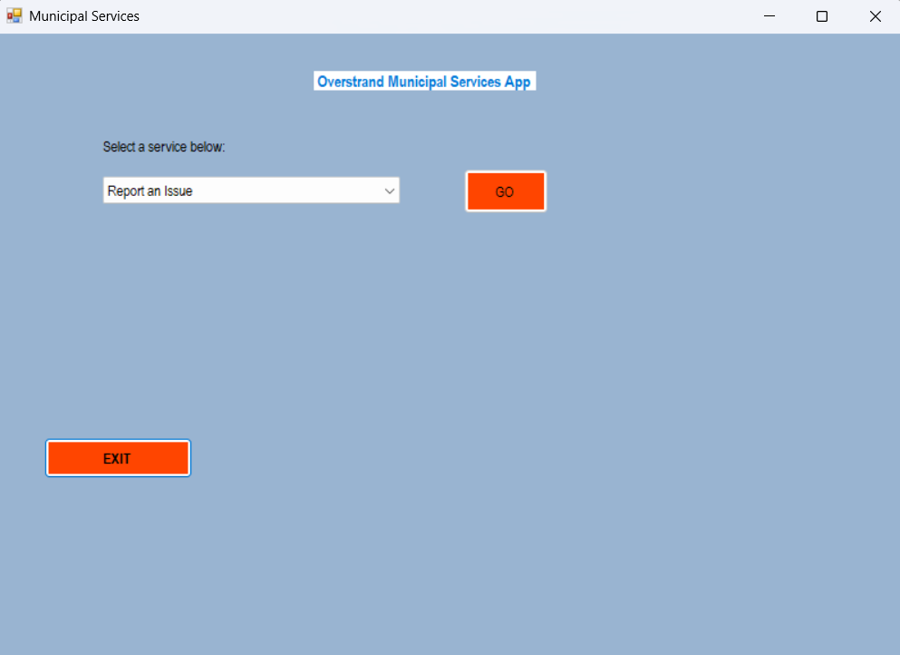
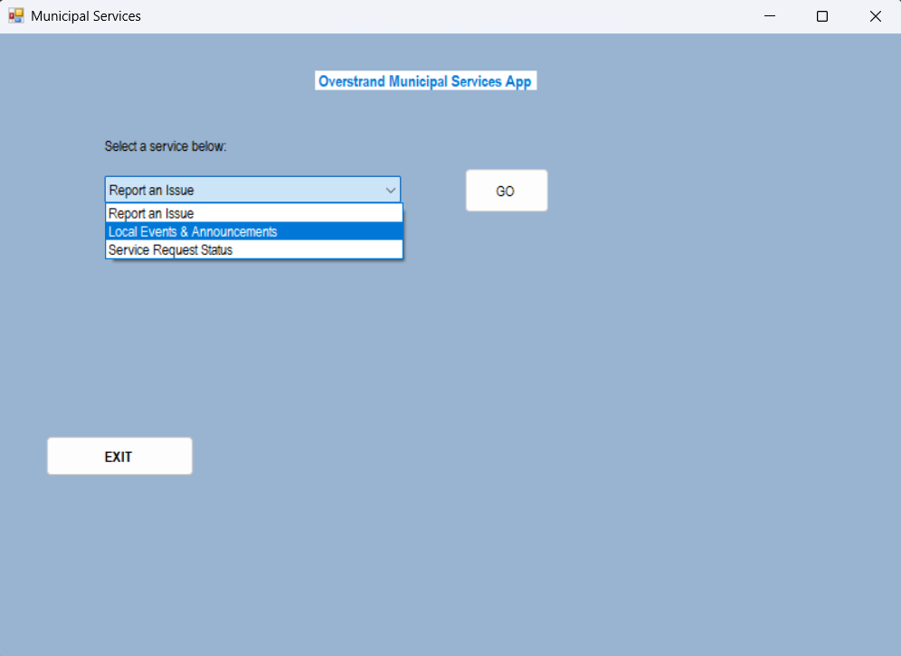
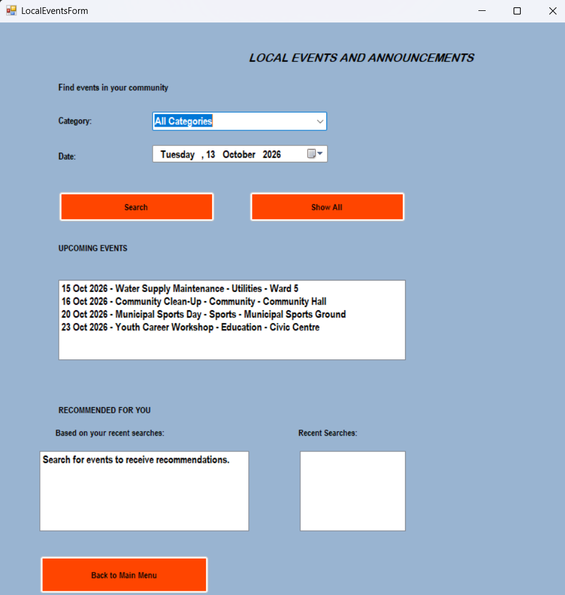
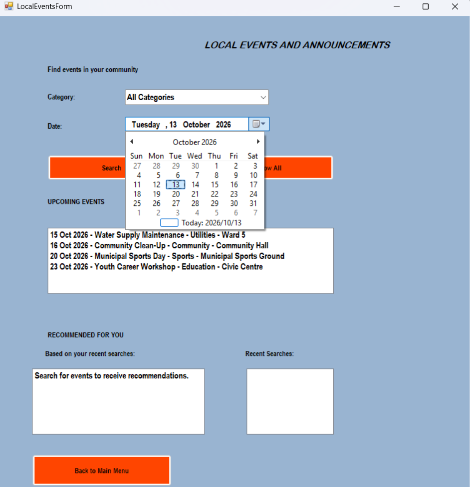
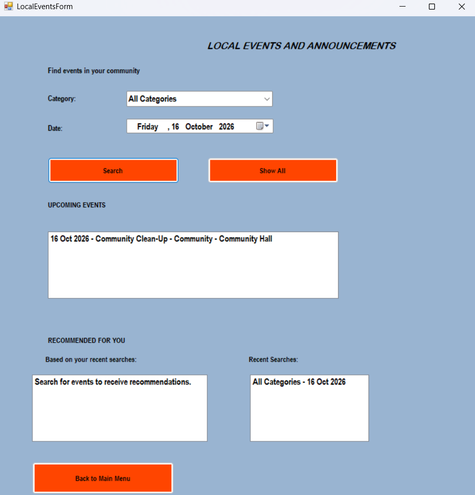
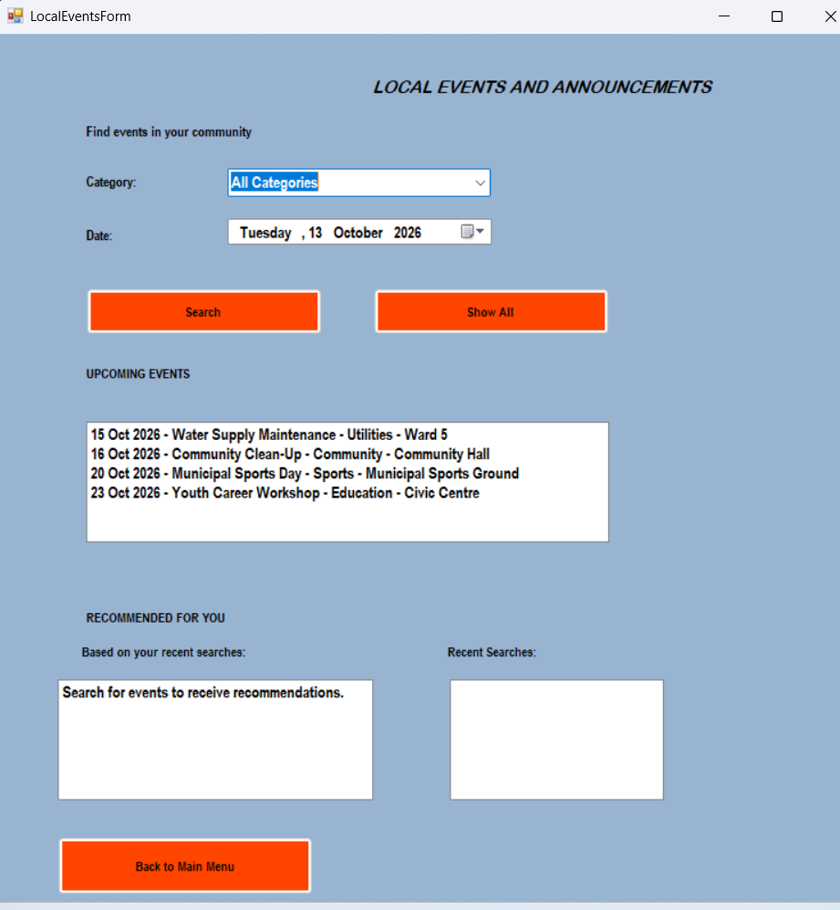
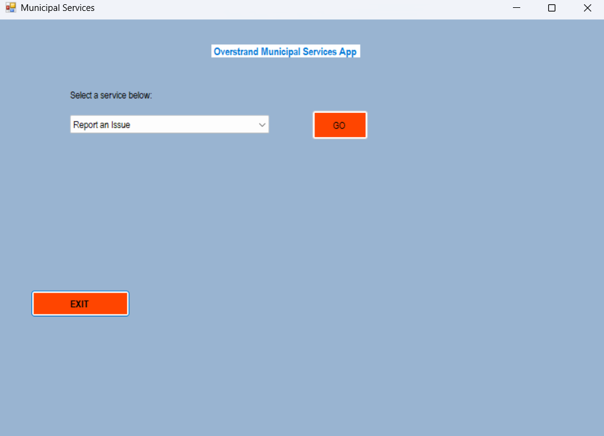
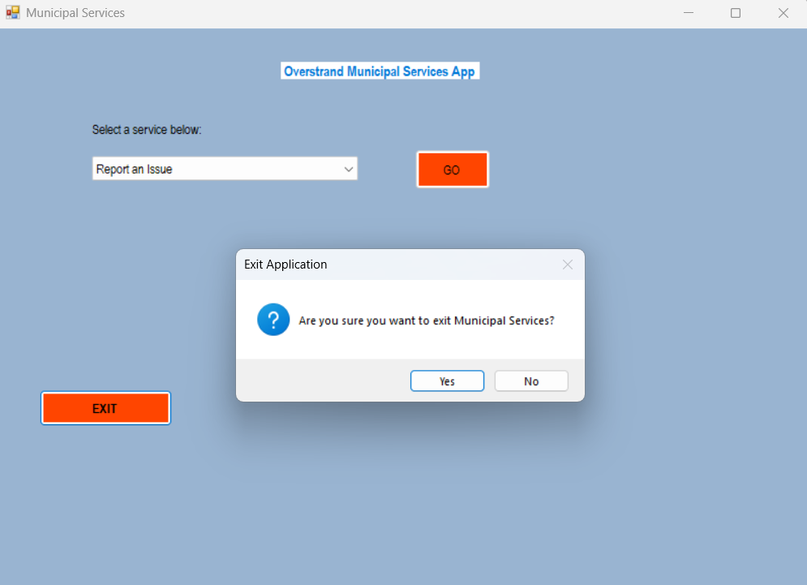

# Municipal Services Application — Part 2

**AAPD7112 | Portfolio of Evidence — Part 2 (Collaboration)**  
**Technology:** C# · Windows Forms · .NET Framework 4.7.2  
**Repository:** https://github.com/Andile707/AAPD7112_Part-2

> This README documents the Part 2 version. Service Request Status is reserved for the later final PoE.

## Overview

MunicipalServicesApp is a C# Windows Forms application developed with .NET Framework 4.7.2 for a South African municipal services scenario. Part 2 extends the Part 1 issue-reporting application by adding Local Events and Announcements, event searching, search history, and category-based recommendations.

## Scope of Part 2

Implemented in Part 1: Report an Issue, required-field validation, optional attachments, issue reference numbers, and an issue-completion progress indicator. Added in Part 2: event listings, category and date searches, chronological upcoming events, recent searches, and recommendations. Service Request Status is a menu option reserved for the later final PoE and is not presented as completed in this Part 2 submission.

## Requirements

Windows computer; Microsoft Visual Studio with .NET desktop development workload; .NET Framework 4.7.2 targeting/developer pack (install if Visual Studio requests it).

## Build and run

Clone or download the repository. In Visual Studio, open MunicipalServicesApp.slnx at the repository root. Allow the solution to load, select Build > Build Solution (Ctrl+Shift+B), then run with F5 or Debug > Start Debugging. The Municipal Services main menu opens.

## Using the application

From the main menu, choose Report an Issue to enter a location, category and description, optionally attach supporting material, and submit. For Part 2, select Local Events & Announcements and click GO. Choose a category (or All Categories) and a date, then click Search. Matching events appear in the Upcoming Events list; when none match, the form displays a no-results message. Click Show All to display all upcoming events in date order. Recent Searches displays the latest searches first. After searches for specific categories, Recommended For You suggests upcoming events in the most frequently searched category. Click Back to Main Menu to return. Exit requests confirmation.

**Main menu**



**Selecting Local Events & Announcements**



**Local Events and Announcements**



**Category selection**



**Date selection**



**Event search**


**Search with no matching events**



**Recent searches**


**Recommendation area**



**Exit confirmation**



## Sample event data

The submitted LocalEventsForm code loads four illustrative events: Community Clean-Up (Community), Municipal Sports Day (Sports), Water Supply Maintenance (Utilities), and Youth Career Workshop (Education). Their dates are calculated relative to the current day; these are sample records, not a live municipal feed.

## Data structures and algorithms

SortedDictionary<DateTime, List<LocalEvent>> groups events by calendar date and maintains date ordering. HashSet<string> keeps event categories unique. Stack<string> stores recent searches with last-in, first-out ordering. Dictionary<string, int> counts searches by specific category for recommendations. Queue<LocalEvent> stores upcoming events in chronological insertion order for display. List<ReportedIssue> holds issue reports in memory in IssueRepository. These collections are static in the supplied repositories; data is not automatically persisted after the application closes.

### EventRepository.cs (actual repository declarations)

```csharp
public static SortedDictionary<DateTime, List<LocalEvent>> EventsByDate
    = new SortedDictionary<DateTime, List<LocalEvent>>();
public static HashSet<string> Categories = new HashSet<string>();
public static Stack<string> SearchHistory = new Stack<string>();
public static Dictionary<string, int> SearchPreferences
    = new Dictionary<string, int>();
public static Queue<LocalEvent> UpcomingEventsQueue
    = new Queue<LocalEvent>();
```

### IssueRepository.cs (actual repository declaration)

```csharp
public static class IssueRepository
{
    public static List<ReportedIssue> Issues { get; }
        = new List<ReportedIssue>();
}
```

## Recommendation logic

On Search, the application records the selected category and date in the stack. For a specific category (not All Categories), it increments the corresponding frequency in SearchPreferences. The recommendation routine finds the category with the highest recorded count and displays events from that category whose dates are today or later. Before a specific-category search, it prompts the user to search for recommendations.

### Category frequency tracking (excerpt from code)

```csharp
if (category != "All Categories")
{
    if (EventRepository.SearchPreferences.ContainsKey(category))
        EventRepository.SearchPreferences[category]++;
    else
        EventRepository.SearchPreferences[category] = 1;
}
```

## Limitations and future development

Event data is illustrative and held in memory. Search matches a selected calendar date and category, rather than a date range. Recommendations are based on category frequency, not machine learning. Service Request Status and advanced tree/graph structures belong to the later final PoE, not the Part 2 implementation described here.

## Repository and evidence

Source repository: https://github.com/Andile707/AAPD7112_Part-2. The Screenshots folder contains GUI images extracted from the supplied Part 2 Readme word document. The original submission document provides further walkthroughs and screenshots.

## Quick checklist

- [ ] Open `MunicipalServicesApp.slnx` in Visual Studio
- [ ] Build without errors
- [ ] Test Report an Issue
- [ ] Test event category and date searches
- [ ] Test Show All and Recent Searches
- [ ] Test recommendations after searching a specific category
